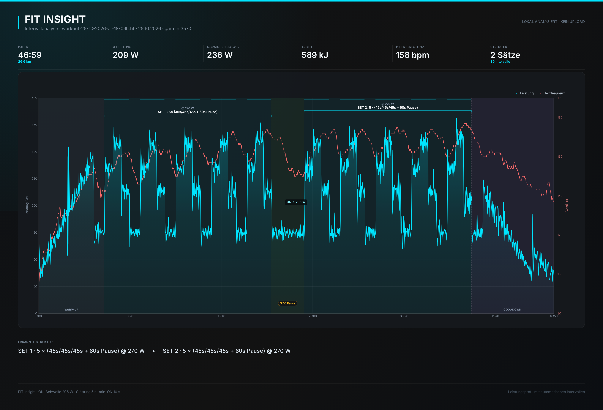

# FIT Insight

Lokale Web-App zur Analyse von Garmin-/Rad-FIT-Dateien: FIT einlesen, Intervalle
automatisch erkennen, als interaktives Leistungsprofil visualisieren und inklusive
aller Annotationen als PNG exportieren.

Kein Upload, kein Backend, keine Datenbank. Das Parsing und die komplette Analyse
laufen zu 100 % im Browser.



## Live-Demo

Die App ist als statische Seite auf GitHub Pages gehostet – einfach eine
`.fit`-Datei per Drag & Drop auf der Startseite ablegen oder die integrierte
Demo-Fahrt laden.

## Features

- **FIT-Parsing im Browser** über das offizielle Garmin FIT SDK
  (Power, Herzfrequenz, Trittfrequenz, Speed, Distanz, Session-Metadaten).
- **Automatische Intervallerkennung** mit geglätteter Leistung, Otsu-Schwelle,
  Hysterese, Stufen-Splitting und Gruppierung zu Sätzen
  (`5 × 45/45/45 s + 60 s Pause @ 270 W`).
- **Lap-Marker-Modus**: sind im FIT-File Workout-Laps enthalten (z. B. strukturierte
  Garmin-Workouts), werden deren exakte Grenzen als Intervallränder bevorzugt.
- **Live-Feintuning** von ON-Schwelle, Glättung, Mindestdauern, Satz-Trennung und FTP.
  Jede Änderung berechnet die Analyse sofort neu.
- **Dark-Mode-Dashboard** (`#121212`, Akzent `#00E5FF`) mit Kennzahlen, Satzkarten,
  Intervalltabelle und Zonenverteilung.
- **Chart.js-Visualisierung** mit Leistung + Herzfrequenz, Phasen-Schattierung,
  ON-Balken, Satz-Klammern, Schwellenlinie und Tooltips.
- **Schritt-Annotation**: in langen Tempo-Blöcken werden nachhaltige
  Leistungssprünge (z. B. 236 → 246 → 236 W) als Stufen annotiert – in der
  Satzkarte, der Intervalltabelle und als Pillen im Chart. Die Intervallgrenzen
  selbst ändern sich nicht.
- **PNG-Export** in 4000 × 2720 px: eigene hochauflösende Chart-Instanz plus
  Kopfzeile, KPIs und Strukturübersicht – Annotationen sind bereits im Canvas.
- **CSV-/JSON-Export** der Intervalle bzw. der kompletten Analyse.
- **Demo-Fahrt** zum sofortigen Ausprobieren ohne FIT-Datei.

## Entwicklung

Voraussetzungen: Node.js ≥ 20.19.

```bash
npm install
npm run dev        # http://localhost:5173
npm test           # 24 Unit-Tests
npm run typecheck
npm run build      # Production-Build nach dist/
npm run preview
```

## Bedienung

1. `.fit`-Datei per Drag & Drop oder Dateiauswahl laden (max. 80 MB).
2. Die App schätzt im Auto-Modus eine ON-Schwelle und erkennt Sätze/Intervalle.
3. Über die linke Leiste nachjustieren:
   - **ON-Schwelle**: ab welcher Leistung ein Block als Belastung gilt.
   - **Glättung**: zentrierter Mittelwert; 5 s unterdrückt kurze Leistungsspitzen.
   - **min. Belastung / min. Erholung**: kürzere Blöcke werden verworfen bzw. Lücken geschlossen.
   - **Satz-Trennung**: Pausen länger als dieser Wert starten einen neuen Satz.
   - **FTP**: optional; aktiviert IF, TSS und die Zonenreferenz.
4. **PNG exportieren** erzeugt ein fertig komponiertes Bild mit allen Markierungen.
5. **CSV** exportiert die Intervalltabelle (inkl. Stufen), **JSON** die komplette
   Analyse inkl. Einstellungen.

## Erkennungsalgorithmus

Die Pipeline ist bewusst erklärbar und ohne Blackbox:

1. **Resampling** – FIT-Records werden sortiert, dedupliziert und auf ein 1-Hz-Raster
   gebracht. Lücken ≤ 15 s werden linear interpoliert, längere bleiben als `null`
   sichtbar und zählen in der Analyse als 0 W.
2. **Glättung** – zentrierter gleitender Mittelwert über die eingestellte Fensterbreite.
3. **Auto-Schwelle** – Otsu-Segmentierung auf einem 1-W-Histogramm. Ist die Verteilung
   nicht klar zweigipflich (z. B. gleichmäßige Endurance-Fahrt), greift ein
   Perzentil-Fallback. Der Slider überschreibt die Schätzung jederzeit.
4. **Hysterese** – Binärmaske an der Schwelle; ON-Blöcke unter `min. Belastung`
   werden verworfen, OFF-Lücken unter `min. Erholung` geschlossen (mehrere Durchläufe).
5. **Stufen-Splitting** – kurze ON-Blöcke (90–240 s) werden an ausgeprägten
   Leistungsstufen zerlegt. Dadurch erscheint ein Workout wie 5 × 45/45/45 s als
   drei 45-s-Intervalle pro Wiederholung statt als ein verschmolzener 2:15-Block.
   Monotone Rampen (z. B. ein Warm-up-Surge) werden dabei verworfen.
6. **Lap-Marker** – zeichnet das Garmin-Workout Belastung und Pause als eigene Laps
   auf (z. B. 45-s-Steps oder 8/8/10-min-Blöcke), werden deren exakte Grenzen
   bevorzugt. Ohne solche Marker greift die rein leistungsbasierte Erkennung.
7. **Kontrast-Prüfung** – nur Blöcke, die sich deutlich von der umgebenden Erholung
   abheben (mind. 12 W und 18 % bzw. 40 W Differenz), gelten als Intervall. Bleibt
   genau ein Block übrig, muss er zusätzlich mindestens 30 % bzw. 45 W über der
   Erholung liegen. Bei langen Einzel-Blöcken (≥ 15 min) wird die Erholungs-Referenz
   aus einem weiteren Umfeld (bis 600 s) gezogen, damit Warm-up- und Cool-down-Rampen
   den Kontrast nicht verfälschen. Das verhindert Pseudo-Sätze bei gleichmäßigen
   Endurance-Fahrten. Stopps und Sensorlücken (< 20 W) zählen nicht als Erholungsreferenz.
8. **Satz-Gruppierung** – aufeinanderfolgende ON-Blöcke werden zu einem Satz, solange
   die Pause ≤ `Satz-Trennung` ist und die Intensität nicht um mehr als 30 % springt.
   Mehrstufige Wiederholungen (z. B. 3 × 45 s) werden als Muster erkannt und im
   Satzlabel zusammengefasst.
9. **Schritt-Annotation** – werden in Blöcken ≥ 8 min nachhaltige Leistungssprünge
   (z. B. 236 → 246 → 236 W) erkannt, werden sie als Stufen in der Satzkarte, der
   Intervalltabelle und als Pillen im Chart annotiert. Die Intervallgrenzen ändern
   sich dadurch nicht.
10. **Metriken** – Ø/Max-Leistung, Arbeit (kJ), Ø/Max-HF, Trittfrequenz, Normalized Power
    (30-s-Fenster, vierte Potenz), optional IF/TSS und Zeit in sechs Leistungszonen.
11. **Phasen** – Warm-up, Sätze, Erholung zwischen Sätzen und Cool-down.

Die Intervalle selbst werden auf den **unglätteten** Rohdaten ausgewertet; geglättet
wird nur die Segmentierung.

## Projektstruktur

```text
fit-insight/
├── index.html                  # Dashboard-Markup
├── public/favicon.svg
├── src/
│   ├── main.ts                 # App-State, Events, Analyse-Orchestrierung
│   ├── styles.css              # Dark-Mode-Design, responsive Layout
│   ├── config.ts               # Defaults & Limits
│   ├── types.ts                # Gemeinsame Typen
│   ├── analysis/
│   │   ├── analyze.ts          # Gesamt-Pipeline
│   │   ├── series.ts           # 1-Hz-Resampling & Interpolation
│   │   ├── threshold.ts        # Otsu-Auto-Schwelle
│   │   ├── detect.ts           # Hysterese, Intervalle, Sätze, Phasen, Schritte
│   │   ├── metrics.ts          # NP, IF/TSS, Arbeit, Zonen
│   │   └── math.ts             # Median, Perzentile, Glättung, NP
│   ├── chart/
│   │   ├── chartConfig.ts      # Chart.js-Konfiguration & Annotationen
│   │   ├── phasePlugin.ts      # ON-Balken, Satz-Klammern, Phasenlabels, Schritt-Pillen
│   │   ├── downsample.ts       # LTTB, lückenerhaltend
│   │   ├── exportPng.ts        # Offscreen-Chart → komponiertes PNG
│   │   └── setup.ts            # Chart.js-Registrierung
│   ├── fit/
│   │   ├── parseFit.ts         # FIT-Decoder & Normalisierung
│   │   └── demoRide.ts         # deterministische Demo-Fahrt
│   ├── ui/
│   │   ├── render.ts           # KPIs, Sätze, Tabelle, Zonen
│   │   ├── exportData.ts       # CSV/JSON
│   │   ├── toast.ts            # Statusmeldungen
│   │   └── dom.ts
│   └── utils/
│       ├── format.ts
│       └── download.ts
└── tests/                      # Parser, Resampling, Schwellen, Erkennung, Downsampling, Schritte
```

## Tests & Deployment

```bash
npm test
```

Abgedeckt sind unter anderem:

- FIT-Roundtrip mit dem Garmin **Encoder** (echte Binärdatei → Decoder → Analyse),
- Intervallerkennung der Demo-Fahrt inklusive 30/30-, 60/60- und 30/30-Sätzen,
- Lücken-/Interpolationsverhalten des Resamplings,
- Auto-Schwelle bei bimodaler und gleichmäßiger Verteilung,
- lückenerhaltendes LTTB-Downsampling,
- Einzel-Block-Kontrast mit weitem Referenzfenster (lange Tempo-Blöcke),
- Schritt-Annotation (nachhaltige Sprünge, Rampen, kurze Blöcke).

Der Push auf den Default-Branch triggert den Workflow
`.github/workflows/pages.yml`: Installieren, Testlauf, Production-Build und
Deployment auf GitHub Pages. Die Seite ist danach unter
`https://<user>.github.io/fit-insight/` erreichbar (`base: './'` in der Vite-Config
sorgt für relative Asset-Pfade).

## Datenschutz & Sicherheit

- FIT-Dateien werden ausschließlich per `File.arrayBuffer()` im Browser gelesen.
- Es gibt keine API, keine Analytics und keine externen Requests.
- Der PNG-Export läuft vollständig clientseitig.
- Das Repository enthält bewusst **keine echten FIT-Beispieldateien** – die
  Erkennung wurde lokal gegen reale Garmin-Workouts validiert (45/45/45-s-Steps,
  8/8/10-min-Blöcke, Over-Unders, 60/60 sowie flache Tempo- und Dauerfahrten),
  die Dateien selbst bleiben auf dem Gerät des Eigentümers.

## Grenzen

- Für die Intervallererkennung sind **Leistungsdaten** nötig; reine HF-Fahrten
  werden geparst, aber ohne Intervalle dargestellt.
- Die Auto-Schwelle ist eine Heuristik und ersetzt keine individuelle FTP-Testung.
- Nur `.fit` (kein `.fit.gz`, `.tcx` oder `.gpx`).
- Die FIT-SDK-Nutzung unterliegt der
  [Garmin FIT Protocol License](https://developer.garmin.com/fit/download/).
- Chart.js und chartjs-plugin-annotation stehen unter MIT-Lizenz.
